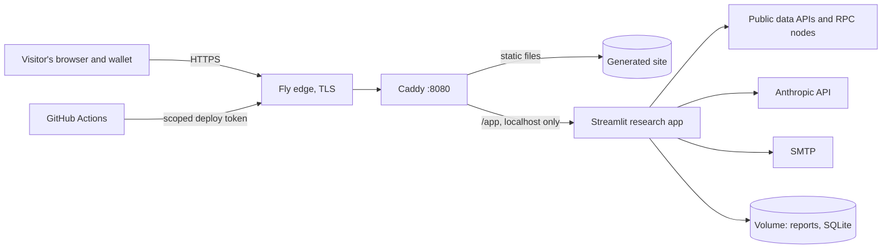

# Threat Model

**Scope:** the production deployment at https://blockchain-research-platform.fly.dev and the repository that builds it.
**Method:** assets first, then trust boundaries, then threats grouped by STRIDE (spoofing, tampering, repudiation, information disclosure, denial of service, elevation of privilege). Every threat names its control and where that control is tested.
**Last reviewed:** 19 October 2026. Review it in every release pull request that changes payments, authentication, the data path or the deployment.

## Assets

| Asset | Why it matters |
|---|---|
| Payments to the business wallet | Real money; a forged unlock costs the operator AI spend for nothing |
| The Anthropic API key | Anyone holding it can spend the operator's credit |
| SMTP credentials and payer email addresses | Personal information (POPIA) and a channel that can send mail as the platform |
| The Fly and GitHub deploy tokens | Whoever holds them can change what runs in production |
| Report content and the public site | Visitors trust what the site shows; a defaced or injected page harms them |
| The platform's education-not-advice position | Advice-like output creates legal exposure (see COMPLIANCE.md) |

## Trust boundaries

Everything left of Caddy is untrusted. Data from public APIs, RPC nodes and the AI model is also treated as untrusted input.

## Threats and controls

| # | Threat (STRIDE) | Control | Tested by |
|---|---|---|---|
| T1 | **Spoofing:** claiming someone else's or an old transfer to the wallet as a payment | Payment must be under 60 minutes old, to the configured wallet, in an accepted token contract on the named chain, for the full amount; fails closed if the block time cannot be read | `tests/test_payment_verifier.py` |
| T2 | **Spoofing:** reusing one transaction to unlock many write-ups | Unique transaction hash in the payments table; reuse allowed only to retry an undelivered write-up for the same token | `tests/test_report_store.py`, `db.report_exists_for_payment` |
| T3 | **Tampering:** a fake token contract with a USDC-like symbol | Only the exact contract addresses in `payment_verifier.NETWORKS` count, each checked on-chain | `tests/test_payment_verifier.py`; the monitor re-checks contracts every 30 minutes |
| T4 | **Tampering:** cross-site scripting through report text (the AI or a data source writes `<script>` or a `javascript:` link) | Raw HTML escaped, unsafe link schemes removed, Jinja2 autoescape, a content security policy with no inline scripts | `tests/test_sitegen.py` |
| T5 | **Tampering:** path traversal through a token symbol (`../`) | Tickers limited to letters and digits before any file path is built | `tests/test_report_store.py` |
| T6 | **Tampering:** a poisoned dependency or GitHub Action | Pinned versions, actions pinned by commit, images by digest, pip-audit and Dependabot | `.github/workflows/security.yml` |
| T7 | **Repudiation:** a payer disputes a payment, or an answer is questioned later | Every payment stored with hash, chain, payer, amount and verification method; every AI call logged with its model | `scripts/payments_report.py`, `usage_log.txt` |
| T8 | **Information disclosure:** a secret committed to the repository | Secrets only in Fly and GitHub secrets; Gitleaks scans the full history on every pull request and before every commit | `security.yml`, `.pre-commit-config.yaml` |
| T9 | **Information disclosure:** payer email addresses exposed | Stored only in the payments table on the private volume; never rendered on a page; sent only to the payer and the operator | Code review; no template reads `payer_email` |
| T10 | **Denial of service and cost:** free AI write-ups on the operator's key | `AI_REQUIRES_PAYMENT=true` in production; AI only runs after a verified payment | `tests/test_llm_and_config.py` |
| T11 | **Denial of service:** a public API or RPC node goes down | Every adapter fails to a labelled "No data", never to "Clear"; the static site keeps its last good pages | `tests/test_chains.py`, `tests/test_risk_profile.py` |
| T12 | **Elevation of privilege:** a compromised process takes over the machine | All processes run as the unprivileged `app` user; Streamlit listens on localhost only; only Caddy is exposed | `security.yml` container job asserts the user |
| T13 | **Elevation of privilege:** a bad change reaches production | Protected `main`, required checks, staging deploy and end-to-end check on every pull request, smoke test after every deploy | Branch protection; `deploy.yml`, `deploy-staging.yml` |
| T14 | **Advice-like output** published as research | Advice-language check on every write-up and data report; code-owned disclaimer | `tests/test_compliance.py` |

## Accepted risks

- **No user accounts.** The platform has no logins; there is nothing to take over, and nothing to protect with access control beyond the operator's own accounts.
- **Streamlit's content security policy is looser than the site's.** Streamlit needs inline scripts. The app's pages show only what the payer fetched, and framing, form targets, plugins and the base URL are restricted.
- **One machine and one volume.** An outage of the machine takes the site down until Fly restarts it; daily volume snapshots bound data loss to a day.
- **Public RPC endpoints can be wrong or down.** Verification falls back to Etherscan's API; a fully unreachable chain blocks payment on that chain, it never accepts one.
- **USDC and USDT counted at one US Dollar each.** A depeg would need the rule revisited.
