# Work Breakdown Structure: Blockchain Research Platform

**Repository:** https://github.com/Africas-Blockchain-Club/blockchain-research-platform
**Last updated:** 18 October 2026, from README.md, docs/, the code layout, deploy.md and the git history to pull request #1 (release 2026.10.19)
**Method:** deliverable-based WBS following the PMBOK definition and the 100% Rule (see workbreakdownstructure.com)

## Scope statement

An educational platform from Africa's Blockchain Club that teaches people to research a blockchain: what it is for, how it is secured, how healthy its network is, and what its native asset's public data shows. It produces reports that explain and never advise, sells optional AI write-ups for a small stablecoin payment, and runs as a public website.

**In scope:** the research content, data adapters, public site and research app, payments and delivery, the production platform and its pipeline, the security and quality standards, documentation, and the two teaching examples kept in the repository.

**Out of scope:** financial advice of any kind; custody of anyone's funds; the lesson notes from the ended workshop series (kept in the PeterManda repository); the Africa's Blockchain Club website itself.

## The WBS

Status: **Done** (with evidence) · **In progress** · **Planned** · **Planning package** (scope known, detail not yet)

- **1 Research content**
  - 1.1 Blockchain Research Protocol - Done
  - 1.2 Blockchain profiles for the featured chains - Done
  - 1.3 Rule-based risk checks - Done
  - 1.4 Data-only report - Done
  - 1.5 AI write-up and advice check - Done
- **2 Data integration**
  - 2.1 Market data adapters - Done
  - 2.2 Network data adapters - Done
  - 2.3 AI adapter - Done
  - 2.4 Chart screenshot adapter - Done
  - 2.5 Developer activity adapter - Done
- **3 User interface**
  - 3.1 Static public site - Done
  - 3.2 Research app - Done
  - 3.3 ABC front-end implementation - Done
  - 3.4 Wallet components - Done
  - 3.5 Attack cost teaching page - Done
- **4 Payments and delivery**
  - 4.1 Multichain payment verification - Done
  - 4.2 Payer email delivery - Done
  - 4.3 Owner alerts - Done
  - 4.4 Payment records and report - Done
- **5 Platform and operations**
  - 5.1 Container image - Done
  - 5.2 Production environment - Done
  - 5.3 Staging environment - Done
  - 5.4 Continuous integration - Done
  - 5.5 Continuous deployment - Done
  - 5.6 Branch protection and pull-request workflow - Done
  - 5.7 Live monitoring - Done
- **6 Security**
  - 6.1 Security policy - Done
  - 6.2 Threat model - Done
  - 6.3 Dependency scanning - Done
  - 6.4 Secret scanning - Done
  - 6.5 Static analysis - Done
  - 6.6 Supply-chain pinning - Done
  - 6.7 HTTP security headers - Done
  - 6.8 Runtime hardening - Done
  - 6.9 Money safeguards - Done
  - 6.10 Education-not-advice compliance - Done
- **7 Quality**
  - 7.1 Automated test suite - Done
  - 7.2 Linting - Done
  - 7.3 Pre-commit hooks - Done
- **8 Documentation**
  - 8.1 README - Done
  - 8.2 Contributing guide - Done
  - 8.3 Compliance and front-end notes - Done
  - 8.4 Operations guide - Done
  - 8.5 Change log - Done
  - 8.6 Architecture decision records - Done
- **9 Project management**
  - 9.1 Work Breakdown Structure - Done
  - 9.2 Collaboration templates - Done
- **10 Standalone teaching examples**
  - 10.1 Blockchain wallet explorer - Done
  - 10.2 x402 agent payment demo - Done

```mermaid
flowchart TD
  P["Blockchain Research Platform"]
  P --> E1["1 Research content"]
  P --> E2["2 Data integration"]
  P --> E3["3 User interface"]
  P --> E4["4 Payments and delivery"]
  P --> E5["5 Platform and operations"]
  P --> E6["6 Security"]
  P --> E7["7 Quality"]
  P --> E8["8 Documentation"]
  P --> E9["9 Project management"]
  P --> E10["10 Standalone teaching examples"]
  E1 --> W1_1["1.1 Blockchain Research Protocol"]
  E1 --> W1_2["1.2 Blockchain profiles for the featured chains"]
  E1 --> W1_3["1.3 Rule-based risk checks"]
  E1 --> W1_4["1.4 Data-only report"]
  E1 --> W1_5["1.5 AI write-up and advice check"]
  E2 --> W2_1["2.1 Market data adapters"]
  E2 --> W2_2["2.2 Network data adapters"]
  E2 --> W2_3["2.3 AI adapter"]
  E2 --> W2_4["2.4 Chart screenshot adapter"]
  E2 --> W2_5["2.5 Developer activity adapter"]
  E3 --> W3_1["3.1 Static public site"]
  E3 --> W3_2["3.2 Research app"]
  E3 --> W3_3["3.3 ABC front-end implementation"]
  E3 --> W3_4["3.4 Wallet components"]
  E3 --> W3_5["3.5 Attack cost teaching page"]
  E4 --> W4_1["4.1 Multichain payment verification"]
  E4 --> W4_2["4.2 Payer email delivery"]
  E4 --> W4_3["4.3 Owner alerts"]
  E4 --> W4_4["4.4 Payment records and report"]
  E5 --> W5_1["5.1 Container image"]
  E5 --> W5_2["5.2 Production environment"]
  E5 --> W5_3["5.3 Staging environment"]
  E5 --> W5_4["5.4 Continuous integration"]
  E5 --> W5_5["5.5 Continuous deployment"]
  E5 --> W5_6["5.6 Branch protection and pull-request workflow"]
  E5 --> W5_7["5.7 Live monitoring"]
  E6 --> W6_1["6.1 Security policy"]
  E6 --> W6_2["6.2 Threat model"]
  E6 --> W6_3["6.3 Dependency scanning"]
  E6 --> W6_4["6.4 Secret scanning"]
  E6 --> W6_5["6.5 Static analysis"]
  E6 --> W6_6["6.6 Supply-chain pinning"]
  E6 --> W6_7["6.7 HTTP security headers"]
  E6 --> W6_8["6.8 Runtime hardening"]
  E6 --> W6_9["6.9 Money safeguards"]
  E6 --> W6_10["6.10 Education-not-advice compliance"]
  E7 --> W7_1["7.1 Automated test suite"]
  E7 --> W7_2["7.2 Linting"]
  E7 --> W7_3["7.3 Pre-commit hooks"]
  E8 --> W8_1["8.1 README"]
  E8 --> W8_2["8.2 Contributing guide"]
  E8 --> W8_3["8.3 Compliance and front-end notes"]
  E8 --> W8_4["8.4 Operations guide"]
  E8 --> W8_5["8.5 Change log"]
  E8 --> W8_6["8.6 Architecture decision records"]
  E9 --> W9_1["9.1 Work Breakdown Structure"]
  E9 --> W9_2["9.2 Collaboration templates"]
  E10 --> W10_1["10.1 Blockchain wallet explorer"]
  E10 --> W10_2["10.2 x402 agent payment demo"]
```

## WBS Dictionary

### 1 Research content

| Field | Entry |
|---|---|
| Type | Control account |
| Owner | Peter Manda |
| Description | Everything a reader learns from: the protocol, the profiles, the checks and the two report types. Not the data plumbing (2) or the screens (3). |
| Deliverables | Blockchain Research Protocol, Blockchain profiles for the featured chains, Rule-based risk checks, Data-only report, AI write-up and advice check |
| Acceptance criteria | Every work package below meets its own criteria |
| Milestones | Release 2026.10 (blockchain research and engineering standards) completes the planned packages |
| Status | 5 of 5 work packages done |

#### 1.1 Blockchain Research Protocol

| Field | Entry |
|---|---|
| Type | Work package |
| Owner | Peter Manda |
| Description | The structure every report follows (blueprints/). v3.0 is education, not advice; v4.0 widens it from the token to the blockchain. |
| Deliverables | blueprints/blockchain-research-protocol-v3.0.md |
| Acceptance criteria | Report headings match the protocol; tests check the AI write-up keeps them |
| Milestones | Delivered |
| Risks | Protocol and prompt drift apart; mitigated by REQUIRED_HEADINGS |
| Evidence and links | a7994ae |
| Status | Done |

#### 1.2 Blockchain profiles for the featured chains

| Field | Entry |
|---|---|
| Type | Work package |
| Owner | Peter Manda |
| Description | Hand-checked profiles of Bitcoin, Ethereum, Solana, XRP Ledger, BNB Chain, Avalanche and Hyperliquid: purpose, how it works, consensus, native asset role, sources. Not live data (2.2). |
| Deliverables | data_analytics/chains.py and a profile section in every report |
| Acceptance criteria | Each fact cites an official source; a test checks every featured chain has a complete profile |
| Milestones | Delivered |
| Risks | A stated fact goes stale; each profile carries a 'last checked' date and links |
| Evidence and links | Pull request #1 |
| Status | Done |

#### 1.3 Rule-based risk checks

| Field | Entry |
|---|---|
| Type | Work package |
| Owner | Peter Manda |
| Description | Ten checks, each flagged, clear or no data, never summed. Network checks join them in this release. |
| Deliverables | data_analytics/risk_profile.py |
| Acceptance criteria | tests/test_risk_profile.py passes |
| Milestones | Delivered |
| Risks | Thresholds read as advice; documented as teaching thresholds |
| Evidence and links | a7994ae |
| Status | Done |

#### 1.4 Data-only report

| Field | Entry |
|---|---|
| Type | Work package |
| Owner | Peter Manda |
| Description | The report built by code with no AI: the defined off state for AI. |
| Deliverables | data_analytics/data_report.py |
| Acceptance criteria | tests/test_data_report.py passes; no advice language |
| Milestones | Delivered |
| Risks | None open |
| Evidence and links | a7994ae, afdb903 |
| Status | Done |

#### 1.5 AI write-up and advice check

| Field | Entry |
|---|---|
| Type | Work package |
| Owner | Peter Manda |
| Description | Model-written explanation, rejected if any section is missing or it reads as advice. |
| Deliverables | data_science/ai_generator.py, data_science/compliance.py |
| Acceptance criteria | tests/test_compliance.py and tests/test_report_generator.py pass |
| Milestones | Delivered |
| Risks | Guard too strict or too loose; tested both ways |
| Evidence and links | a7994ae, afdb903 |
| Status | Done |

### 2 Data integration

| Field | Entry |
|---|---|
| Type | Control account |
| Owner | Peter Manda |
| Description | Every adapter that reads an outside service: market, network, AI and screenshot data. One module per dependency, each with an off state. |
| Deliverables | Market data adapters, Network data adapters, AI adapter, Chart screenshot adapter, Developer activity adapter |
| Acceptance criteria | Every work package below meets its own criteria |
| Milestones | Release 2026.10 (blockchain research and engineering standards) completes the planned packages |
| Status | 5 of 5 work packages done |

#### 2.1 Market data adapters

| Field | Entry |
|---|---|
| Type | Work package |
| Owner | Peter Manda |
| Description | CoinGecko, DexScreener by contract address, DefiLlama, Coinglass, news headlines and the exchange rate. |
| Deliverables | data_engineering/fetchers.py |
| Acceptance criteria | Monitor's data pipeline check passes daily |
| Milestones | Delivered |
| Risks | Free API limits; every adapter fails to 'no data', never to 'clear' |
| Evidence and links | a7994ae |
| Status | Done |

#### 2.2 Network data adapters

| Field | Entry |
|---|---|
| Type | Work package |
| Owner | Peter Manda |
| Description | Live network data per featured chain from public sources: block height and time, fees, validators or hash rate, throughput where published. |
| Deliverables | data_engineering/networks.py |
| Acceptance criteria | Each adapter returns data or a labelled error; tests run offline against recorded responses |
| Milestones | Delivered |
| Risks | Public endpoints change or rate-limit; each has a timeout and an off state |
| Evidence and links | Pull request #1 |
| Status | Done |

#### 2.3 AI adapter

| Field | Entry |
|---|---|
| Type | Work package |
| Owner | Peter Manda |
| Description | The only module that calls a model provider; off switch, refusal fallback, usage log. |
| Deliverables | data_science/llm.py |
| Acceptance criteria | tests/test_llm_and_config.py passes |
| Milestones | Delivered |
| Risks | Model retired; model list is configuration |
| Evidence and links | a7994ae |
| Status | Done |

#### 2.4 Chart screenshot adapter

| Field | Entry |
|---|---|
| Type | Work package |
| Owner | Peter Manda |
| Description | Optional Playwright capture of the main pool chart; off on Fly. |
| Deliverables | data_engineering/screenshot_bot.py |
| Acceptance criteria | Report saves with or without a chart |
| Milestones | Delivered |
| Risks | Heavy browser in the image; switched off in production |
| Evidence and links | a7994ae |
| Status | Done |

#### 2.5 Developer activity adapter

| Field | Entry |
|---|---|
| Type | Work package |
| Owner | Peter Manda |
| Description | Commits, stars and last change from each featured chain's main client repository on GitHub, replacing CoinGecko developer data, which its free tier no longer fills. |
| Deliverables | data_engineering/github_activity.py |
| Acceptance criteria | Bitcoin Core shows live commit counts; failures show as No data |
| Milestones | Delivered |
| Risks | GitHub rate limits; GITHUB_TOKEN raises them |
| Evidence and links | Pull request #1 |
| Status | Done |

### 3 User interface

| Field | Entry |
|---|---|
| Type | Control account |
| Owner | Peter Manda |
| Description | Every screen a visitor or payer sees: the static public site, the research app, the wallet components and the ABC front-end implementation. |
| Deliverables | Static public site, Research app, ABC front-end implementation, Wallet components, Attack cost teaching page |
| Acceptance criteria | Every work package below meets its own criteria |
| Milestones | Release 2026.10 (blockchain research and engineering standards) completes the planned packages |
| Status | 5 of 5 work packages done |

#### 3.1 Static public site

| Field | Entry |
|---|---|
| Type | Work package |
| Owner | Peter Manda |
| Description | Plain HTML pages generated from the reports and profiles (home, blockchains, reports, method), served by Caddy for an instant first load. |
| Deliverables | site/ generator and templates, Caddyfile |
| Acceptance criteria | Home loads without Streamlit; pages pass the front-end checks at six widths |
| Milestones | Delivered |
| Risks | Site and app drift; both built from the same theme tokens |
| Evidence and links | Pull request #1 |
| Status | Done |

#### 3.2 Research app

| Field | Entry |
|---|---|
| Type | Work package |
| Owner | Peter Manda |
| Description | The Streamlit app for live research and payments; moves behind /app in this release. |
| Deliverables | dashboards/ |
| Acceptance criteria | Monitor page check passes |
| Milestones | Delivered |
| Risks | Slow first load; mitigated by 3.1 |
| Evidence and links | a7994ae |
| Status | Done |

#### 3.3 ABC front-end implementation

| Field | Entry |
|---|---|
| Type | Work package |
| Owner | Peter Manda |
| Description | The ABC front-end standard applied: tokens, type, logo tile, mascot, video stage. |
| Deliverables | dashboards/ui/theme.py, docs/FRONTEND.md |
| Acceptance criteria | Equal gutters and no sideways scroll at six widths, both themes |
| Milestones | Delivered |
| Risks | Video served as text/plain by Streamlit; served from a CDN |
| Evidence and links | 7d1dc6d |
| Status | Done |

#### 3.4 Wallet components

| Field | Entry |
|---|---|
| Type | Work package |
| Owner | Peter Manda |
| Description | Sign-in and multichain stablecoin payment components in plain HTML. |
| Deliverables | dashboards/wallet_pay/, dashboards/wallet_connect/ |
| Acceptance criteria | Browser test builds the correct transfer against live balances |
| Milestones | Delivered |
| Risks | Wallet API changes; manual hash path as fallback |
| Evidence and links | abe46c5 |
| Status | Done |

#### 3.5 Attack cost teaching page

| Field | Entry |
|---|---|
| Type | Work package |
| Owner | Peter Manda |
| Description | Calculator for the cost of attacking a blockchain, priced with live data. |
| Deliverables | dashboards/views/attack_cost.py |
| Acceptance criteria | Page renders with and without the live price |
| Milestones | Delivered |
| Risks | None open |
| Evidence and links | 48be41c |
| Status | Done |

### 4 Payments and delivery

| Field | Entry |
|---|---|
| Type | Control account |
| Owner | Peter Manda |
| Description | Taking a stablecoin payment, recording it, and delivering the paid write-up and alerts by email. |
| Deliverables | Multichain payment verification, Payer email delivery, Owner alerts, Payment records and report |
| Acceptance criteria | Every work package below meets its own criteria |
| Milestones | Release 2026.10 (blockchain research and engineering standards) completes the planned packages |
| Status | 4 of 4 work packages done |

#### 4.1 Multichain payment verification

| Field | Entry |
|---|---|
| Type | Work package |
| Owner | Peter Manda |
| Description | USDC or USDT on six networks, recent, correct amount, correct recipient, enough confirmations. |
| Deliverables | payment_verifier.py |
| Acceptance criteria | tests/test_payment_verifier.py passes |
| Milestones | Delivered |
| Risks | Depeg of one stablecoin; documented assumption |
| Evidence and links | abe46c5 |
| Status | Done |

#### 4.2 Payer email delivery

| Field | Entry |
|---|---|
| Type | Work package |
| Owner | Peter Manda |
| Description | Paid write-up and receipt emailed as PDF and markdown; payments pause when email is off. |
| Deliverables | emailer.py, dashboards/views/research.py |
| Acceptance criteria | tests/test_emailer.py passes |
| Milestones | Delivered |
| Risks | SMTP outage; owner alerted to send by hand |
| Evidence and links | 7d1dc6d |
| Status | Done |

#### 4.3 Owner alerts

| Field | Entry |
|---|---|
| Type | Work package |
| Owner | Peter Manda |
| Description | Email to the operator on each payment and each paid failure. |
| Deliverables | emailer.alert_owner |
| Acceptance criteria | Test alert delivered from production on 18 October 2026 |
| Milestones | Delivered |
| Risks | Alert loss; monitor and payments report as backstops |
| Evidence and links | abe46c5 |
| Status | Done |

#### 4.4 Payment records and report

| Field | Entry |
|---|---|
| Type | Work package |
| Owner | Peter Manda |
| Description | Payments table with replay guard; read-only report of payments missing a write-up. |
| Deliverables | db.py, scripts/payments_report.py |
| Acceptance criteria | tests/test_report_store.py passes |
| Milestones | Delivered |
| Risks | None open |
| Evidence and links | abe46c5 |
| Status | Done |

### 5 Platform and operations

| Field | Entry |
|---|---|
| Type | Control account |
| Owner | Peter Manda |
| Description | Container, environments, delivery pipeline, branch workflow, monitoring and backups. |
| Deliverables | Container image, Production environment, Staging environment, Continuous integration, Continuous deployment, Branch protection and pull-request workflow, Live monitoring |
| Acceptance criteria | Every work package below meets its own criteria |
| Milestones | Release 2026.10 (blockchain research and engineering standards) completes the planned packages |
| Status | 7 of 7 work packages done |

#### 5.1 Container image

| Field | Entry |
|---|---|
| Type | Work package |
| Owner | Peter Manda |
| Description | Two-stage image, unprivileged user; gains Caddy in this release. |
| Deliverables | Dockerfile, scripts/start.sh |
| Acceptance criteria | Image builds in CI and on Fly |
| Milestones | Delivered |
| Risks | Base image vulnerabilities; scanned in 6.3 |
| Evidence and links | bf0b663 |
| Status | Done |

#### 5.2 Production environment

| Field | Entry |
|---|---|
| Type | Work package |
| Owner | Peter Manda |
| Description | Fly.io app in jnb, always on, 1 GB volume with daily snapshots. |
| Deliverables | fly.toml, deploy.md |
| Acceptance criteria | https://blockchain-research-platform.fly.dev answers; monitor passes |
| Milestones | Delivered |
| Risks | Single machine; documented path to Postgres |
| Evidence and links | bf0b663, abe46c5 |
| Status | Done |

#### 5.3 Staging environment

| Field | Entry |
|---|---|
| Type | Work package |
| Owner | Peter Manda |
| Description | A second Fly app that receives each release candidate before production; payments and AI off. |
| Deliverables | fly.staging.toml |
| Acceptance criteria | Release candidate passes the monitor against staging before merge |
| Milestones | Delivered |
| Risks | Cost; staging stops when idle |
| Evidence and links | Pull request #1 |
| Status | Done |

#### 5.4 Continuous integration

| Field | Entry |
|---|---|
| Type | Work package |
| Owner | Peter Manda |
| Description | Lint and tests on every push and pull request, Python 3.10 and 3.12. |
| Deliverables | .github/workflows/ci.yml |
| Acceptance criteria | Green runs on main |
| Milestones | Delivered |
| Risks | None open |
| Evidence and links | abe46c5 |
| Status | Done |

#### 5.5 Continuous deployment

| Field | Entry |
|---|---|
| Type | Work package |
| Owner | Peter Manda |
| Description | A merge to main that passes CI deploys to production with a scoped deploy token. |
| Deliverables | .github/workflows/deploy.yml |
| Acceptance criteria | A merged pull request appears live with its build number |
| Milestones | Delivered |
| Risks | A bad merge deploys; protected main and staging reduce it |
| Evidence and links | Pull request #1 |
| Status | Done |

#### 5.6 Branch protection and pull-request workflow

| Field | Entry |
|---|---|
| Type | Work package |
| Owner | Peter Manda |
| Description | main accepts changes only by pull request with CI and security checks passing. |
| Deliverables | GitHub branch rules |
| Acceptance criteria | A direct push to main is refused |
| Milestones | Delivered |
| Risks | Slows urgent fixes; administrators can merge a passing pull request |
| Evidence and links | Pull request #1 |
| Status | Done |

#### 5.7 Live monitoring

| Field | Entry |
|---|---|
| Type | Work package |
| Owner | Peter Manda |
| Description | Scheduled end-to-end checks with email on failure, and the brp-check skill. |
| Deliverables | scripts/monitor.py, .github/workflows/monitor.yml |
| Acceptance criteria | Workflow run green; failure path tested |
| Milestones | Delivered |
| Risks | GitHub pauses schedules after 60 days idle; skill checks for it |
| Evidence and links | abe46c5 |
| Status | Done |

### 6 Security

| Field | Entry |
|---|---|
| Type | Control account |
| Owner | Peter Manda |
| Description | The cybersecurity standard: policy, threat model, scanning, supply-chain pinning, headers, runtime hardening and money safeguards. |
| Deliverables | Security policy, Threat model, Dependency scanning, Secret scanning, Static analysis, Supply-chain pinning, HTTP security headers, Runtime hardening, Money safeguards, Education-not-advice compliance |
| Acceptance criteria | Every work package below meets its own criteria |
| Milestones | Release 2026.10 (blockchain research and engineering standards) completes the planned packages |
| Status | 10 of 10 work packages done |

#### 6.1 Security policy

| Field | Entry |
|---|---|
| Type | Work package |
| Owner | Peter Manda |
| Description | How to report a vulnerability, what is in scope, and response times. |
| Deliverables | SECURITY.md |
| Acceptance criteria | Present and linked from the README |
| Milestones | Delivered |
| Risks | None |
| Evidence and links | Pull request #1 |
| Status | Done |

#### 6.2 Threat model

| Field | Entry |
|---|---|
| Type | Work package |
| Owner | Peter Manda |
| Description | Assets, trust boundaries, threats and the control for each. |
| Deliverables | docs/THREAT_MODEL.md |
| Acceptance criteria | Every threat names a control and where it is tested |
| Milestones | Delivered |
| Risks | Model goes stale; reviewed each release |
| Evidence and links | Pull request #1 |
| Status | Done |

#### 6.3 Dependency scanning

| Field | Entry |
|---|---|
| Type | Work package |
| Owner | Peter Manda |
| Description | Dependabot updates and pip-audit on every pull request; container image scan. |
| Deliverables | .github/dependabot.yml, .github/workflows/security.yml |
| Acceptance criteria | Scan runs green or reports a finding |
| Milestones | Delivered |
| Risks | Noise; triage rules in SECURITY.md |
| Evidence and links | Pull request #1 |
| Status | Done |

#### 6.4 Secret scanning

| Field | Entry |
|---|---|
| Type | Work package |
| Owner | Peter Manda |
| Description | Gitleaks across the full history on every pull request. |
| Deliverables | .github/workflows/security.yml |
| Acceptance criteria | History scan clean |
| Milestones | Delivered |
| Risks | A leaked key; rotate and re-scan |
| Evidence and links | Pull request #1 |
| Status | Done |

#### 6.5 Static analysis

| Field | Entry |
|---|---|
| Type | Work package |
| Owner | Peter Manda |
| Description | CodeQL and Bandit on every pull request. |
| Deliverables | .github/workflows/codeql.yml, security.yml |
| Acceptance criteria | No unresolved high findings |
| Milestones | Delivered |
| Risks | False positives; documented suppressions only |
| Evidence and links | Pull request #1 |
| Status | Done |

#### 6.6 Supply-chain pinning

| Field | Entry |
|---|---|
| Type | Work package |
| Owner | Peter Manda |
| Description | Every GitHub Action pinned to a commit hash; Python dependencies pinned. |
| Deliverables | .github/workflows/*.yml, requirements*.txt |
| Acceptance criteria | No action referenced by a moving tag |
| Milestones | Delivered |
| Risks | Pins age; Dependabot updates them |
| Evidence and links | Pull request #1 |
| Status | Done |

#### 6.7 HTTP security headers

| Field | Entry |
|---|---|
| Type | Work package |
| Owner | Peter Manda |
| Description | HSTS, content security policy, framing, referrer and permissions headers from Caddy. |
| Deliverables | Caddyfile |
| Acceptance criteria | Headers present on the live site |
| Milestones | Delivered |
| Risks | A strict policy breaks Streamlit; policy split by path |
| Evidence and links | Pull request #1 |
| Status | Done |

#### 6.8 Runtime hardening

| Field | Entry |
|---|---|
| Type | Work package |
| Owner | Peter Manda |
| Description | Unprivileged container user, secrets only in Fly and GitHub secrets, path-safe token handling. |
| Deliverables | Dockerfile, scripts/start.sh, tools/report_store.py |
| Acceptance criteria | tests reject path-escaping tokens |
| Milestones | Delivered |
| Risks | None open |
| Evidence and links | bf0b663 |
| Status | Done |

#### 6.9 Money safeguards

| Field | Entry |
|---|---|
| Type | Work package |
| Owner | Peter Manda |
| Description | Payment age limit, replay guard, fail-closed verification, AI only behind payment in production. |
| Deliverables | payment_verifier.py, config.py |
| Acceptance criteria | tests/test_payment_verifier.py passes |
| Milestones | Delivered |
| Risks | New network added carelessly; contracts checked on-chain first |
| Evidence and links | bf0b663, abe46c5 |
| Status | Done |

#### 6.10 Education-not-advice compliance

| Field | Entry |
|---|---|
| Type | Work package |
| Owner | Peter Manda |
| Description | No ratings, no recommendations; the advice check and the disclaimer. |
| Deliverables | docs/COMPLIANCE.md, data_science/compliance.py |
| Acceptance criteria | Compliance tests pass |
| Milestones | Delivered |
| Risks | Regulation changes; reviewed before going further with paid features |
| Evidence and links | a7994ae |
| Status | Done |

### 7 Quality

| Field | Entry |
|---|---|
| Type | Control account |
| Owner | Peter Manda |
| Description | Automated tests, linting and local pre-commit checks. Monitoring of the live site sits in 5, not here. |
| Deliverables | Automated test suite, Linting, Pre-commit hooks |
| Acceptance criteria | Every work package below meets its own criteria |
| Milestones | Release 2026.10 (blockchain research and engineering standards) completes the planned packages |
| Status | 3 of 3 work packages done |

#### 7.1 Automated test suite

| Field | Entry |
|---|---|
| Type | Work package |
| Owner | Peter Manda |
| Description | Offline unit and integration tests; no network, no AI, no payments. |
| Deliverables | tests/ |
| Acceptance criteria | pytest green in CI |
| Milestones | Delivered |
| Risks | Coverage gaps in the UI; covered by the monitor's browser check |
| Evidence and links | a7994ae onwards |
| Status | Done |

#### 7.2 Linting

| Field | Entry |
|---|---|
| Type | Work package |
| Owner | Peter Manda |
| Description | Ruff with import ordering and bug-prone patterns. |
| Deliverables | pyproject.toml |
| Acceptance criteria | ruff check clean in CI |
| Milestones | Delivered |
| Risks | None |
| Evidence and links | a7994ae |
| Status | Done |

#### 7.3 Pre-commit hooks

| Field | Entry |
|---|---|
| Type | Work package |
| Owner | Peter Manda |
| Description | The same lint and secret checks before every local commit. |
| Deliverables | .pre-commit-config.yaml |
| Acceptance criteria | pre-commit run --all-files clean |
| Milestones | Delivered |
| Risks | None |
| Evidence and links | Pull request #1 |
| Status | Done |

### 8 Documentation

| Field | Entry |
|---|---|
| Type | Control account |
| Owner | Peter Manda |
| Description | Developer, operator and reader documentation kept in the repository. |
| Deliverables | README, Contributing guide, Compliance and front-end notes, Operations guide, Change log, Architecture decision records |
| Acceptance criteria | Every work package below meets its own criteria |
| Milestones | Release 2026.10 (blockchain research and engineering standards) completes the planned packages |
| Status | 6 of 6 work packages done |

#### 8.1 README

| Field | Entry |
|---|---|
| Type | Work package |
| Owner | Peter Manda |
| Description | What the platform is, how to run it, how it works. |
| Deliverables | README.md |
| Acceptance criteria | A fresh clone runs from it |
| Milestones | Delivered |
| Risks | None |
| Evidence and links | a7994ae onwards |
| Status | Done |

#### 8.2 Contributing guide

| Field | Entry |
|---|---|
| Type | Work package |
| Owner | Peter Manda |
| Description | Rules for code and words. |
| Deliverables | CONTRIBUTING.md |
| Acceptance criteria | Linked from README |
| Milestones | Delivered |
| Risks | None |
| Evidence and links | a7994ae |
| Status | Done |

#### 8.3 Compliance and front-end notes

| Field | Entry |
|---|---|
| Type | Work package |
| Owner | Peter Manda |
| Description | Why the platform never advises; how the front-end standard is met. |
| Deliverables | docs/COMPLIANCE.md, docs/FRONTEND.md |
| Acceptance criteria | Kept in step with each release |
| Milestones | Delivered |
| Risks | None |
| Evidence and links | a7994ae, 7d1dc6d |
| Status | Done |

#### 8.4 Operations guide

| Field | Entry |
|---|---|
| Type | Work package |
| Owner | Peter Manda |
| Description | Deploying, secrets, alerts and the monitor. |
| Deliverables | deploy.md |
| Acceptance criteria | Followed for the live deployment |
| Milestones | Delivered |
| Risks | None |
| Evidence and links | bf0b663 |
| Status | Done |

#### 8.5 Change log

| Field | Entry |
|---|---|
| Type | Work package |
| Owner | Peter Manda |
| Description | Every release with its changes, in Keep a Changelog form. |
| Deliverables | CHANGELOG.md |
| Acceptance criteria | Updated in each release pull request |
| Milestones | Delivered |
| Risks | None |
| Evidence and links | Pull request #1 |
| Status | Done |

#### 8.6 Architecture decision records

| Field | Entry |
|---|---|
| Type | Work package |
| Owner | Peter Manda |
| Description | The significant decisions and why: education not advice, Streamlit plus static site, multichain stablecoins, Fly with one volume. |
| Deliverables | docs/adr/ |
| Acceptance criteria | One record per decision |
| Milestones | Delivered |
| Risks | None |
| Evidence and links | Pull request #1 |
| Status | Done |

### 9 Project management

| Field | Entry |
|---|---|
| Type | Control account |
| Owner | Peter Manda |
| Description | The WBS itself and the collaboration scaffolding: templates and ownership files. |
| Deliverables | Work Breakdown Structure, Collaboration templates |
| Acceptance criteria | Every work package below meets its own criteria |
| Milestones | Release 2026.10 (blockchain research and engineering standards) completes the planned packages |
| Status | 2 of 2 work packages done |

#### 9.1 Work Breakdown Structure

| Field | Entry |
|---|---|
| Type | Work package |
| Owner | Peter Manda |
| Description | This document. |
| Deliverables | docs/WBS.md |
| Acceptance criteria | Passes the WBS checklist |
| Milestones | Delivered |
| Risks | Goes stale; updated each release |
| Evidence and links | Pull request #1 |
| Status | Done |

#### 9.2 Collaboration templates

| Field | Entry |
|---|---|
| Type | Work package |
| Owner | Peter Manda |
| Description | Pull request template, issue templates and code owners. |
| Deliverables | .github/ |
| Acceptance criteria | Templates appear on new pull requests and issues |
| Milestones | Delivered |
| Risks | None |
| Evidence and links | Pull request #1 |
| Status | Done |

### 10 Standalone teaching examples

| Field | Entry |
|---|---|
| Type | Control account |
| Owner | Peter Manda |
| Description | Examples that share the repository but not the platform: the wallet explorer and the x402 demo. |
| Deliverables | Blockchain wallet explorer, x402 agent payment demo |
| Acceptance criteria | Every work package below meets its own criteria |
| Milestones | Release 2026.10 (blockchain research and engineering standards) completes the planned packages |
| Status | 2 of 2 work packages done |

#### 10.1 Blockchain wallet explorer

| Field | Entry |
|---|---|
| Type | Work package |
| Owner | Peter Manda |
| Description | Node.js teaching project. |
| Deliverables | teaching/blockchain-wallet-explorer/ |
| Acceptance criteria | Its own README runs |
| Milestones | Delivered |
| Risks | Dependencies age; covered by Dependabot |
| Evidence and links | a90c251 |
| Status | Done |

#### 10.2 x402 agent payment demo

| Field | Entry |
|---|---|
| Type | Work package |
| Owner | Peter Manda |
| Description | Local-testnet demo of an agent paying an HTTP 402 paywall. |
| Deliverables | x402/ |
| Acceptance criteria | Runs against a local Anvil node |
| Milestones | Delivered |
| Risks | Never pointed at a real key; documented |
| Evidence and links | 3963c5c |
| Status | Done |

## 100% Rule check

- **1 Research content:** the protocol, the profiles, the checks and the two report types are everything a reader is taught; nothing else produces reader-facing content.
- **2 Data integration:** every outside service the code reads is behind one of these four adapters.
- **3 User interface:** every screen is either the static site, the app, a wallet component or the shared front-end layer; the attack cost page is the one teaching screen outside the research flow.
- **4 Payments and delivery:** payment, record, payer email and owner alert are the whole paid path.
- **5 Platform and operations:** image, two environments, CI, CD, branch rules and monitoring cover how code reaches users and stays up; backups are the volume snapshots inside 5.2.
- **6 Security:** policy, model, three kinds of scanning, pinning, headers, runtime hardening, money safeguards and compliance cover the security standard; none of them is repeated in 5 or 7.
- **7 Quality:** tests, lint and pre-commit are every automated check on code before it merges; live checks are in 5.7.
- **8 Documentation:** every document in the repository other than the WBS (9.1) and the security documents (6.1, 6.2).
- **9 Project management:** the WBS and the collaboration scaffolding.
- **10 Standalone teaching examples:** the two folders that share the repository but not the platform.
- **Found but not yet placed:** nothing.

## Change log

| Date | Change | Why |
|---|---|---|
| 18 October 2026 | WBS created, covering the platform to date and the release that adds blockchain research and the engineering standards | Planning the release, and recording the whole scope in one place |
| 19 October 2026 | 17 work packages moved from Planned to Done with pull request #1 as evidence; 2.5 Developer activity adapter added (next free code under 2) | The release was built, checked on staging and reviewed |
